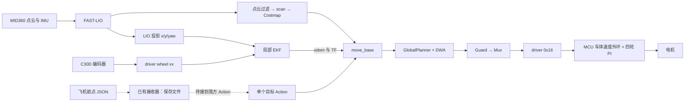

# Slicer UGV Navigation

ROS1 Noetic 非全向小车导航工程。开发主线包含定位/导航接线、标准单目标接口、C30D速度接口与GNSS适配，配套现场问题复盘和软件验证记录。面向无人机同学，先看 [空地接口](docs/03_air_team_guide.md)。

**截至2026-10-30：已有odom导航实车试验；在线建图、深度障碍和GNSS是新软件候选。低速持续转向、直行横偏、停车重复精度及完整空地任务仍待验收。**

## 两个并列仓库

| | 队友方案 | 本仓库 |
|---|---|---|
| 仓库 | [potato-ugv-online-navigation-radio](https://github.com/20DCYy06/potato-ugv-online-navigation-radio) | [slicer-ugv-navigation](https://github.com/20DCYy06/slicer-ugv-navigation) |
| 导航 | Gmapping在线地图＋B样条全局规划＋TEB | 已实测主线为odom＋GlobalPlanner＋DWA；保留TEB对照，新增Gmapping在线候选 |
| 任务入口 | 单点工具与已有巡航程序 | 标准 `/ugv/move_base` 单目标Action及预览/取消工具 |
| 通信 | FKIE、航点接收存盘、状态relay | 沿用相同接口约定，接到我方Action的适配尚待完成 |
| 定位与底盘 | Slicer传感器与C30D基础 | 复用既有基础，保留我方driver/Guard适配、EKF响应与固件修复证据 |
| 学习重点 | 在线导航组合、巡航与电台通信 | 分层接口、实车问题定位、最小修改与验收边界 |

本次对照队友提交 [643a704](https://github.com/20DCYy06/potato-ugv-online-navigation-radio/tree/643a704c5fa042b5e9f08d3c37ddad3a38e8b56a)。两边各自维护源码和版本；共同依赖需要选定来源，不能因文件同名就认为版本相同。队友完整入口与本仓库入口的启动默认不同，运行时选定一套导航/定位/串口所有者。

本地可以并列放置：

```text
ugv-projects/                           # 普通目录
├── potato-ugv-online-navigation-radio/ # 队友仓库
└── slicer-ugv-navigation/              # 本仓库，Catkin工作区根
```

## 系统架构



EKF只融合LIO x/y/yaw与轮速vx，没有把MCU IMU作为第二路EKF输入。MCU以车体速度和板载gyro构成局部速度闭环，导航以融合位姿修正最终位置/朝向；0x16发送vx/wz，不是角度目标。

## 目录与阅读顺序

```text
src/                             唯一开发主线
  ugv_bringup/                   launch与配置
  ugv_navigation/                Action工具、深度适配、导航测试
  ugv_slicer_control/            Guard/Mux、driver与协议
  cup_gnss/                      GNSS/NTRIP、质量判断、ENU
tools/                           采样、分析、预览、离线检查
docs/                            架构、复盘、接口、验收与复现
  history/                       按日期保存的旧说明
reference/                       共用依赖与固件参考，CATKIN_IGNORE
evidence/                        精选验证记录，CATKIN_IGNORE
Dockerfile                       我方Noetic开发环境依赖入口
```

| 阅读目的 | 文档 |
|---|---|
| 了解数据流与实际入口 | [架构与源码](docs/01_architecture.md) |
| 了解做过什么、问题为何发生、修到了哪里 | [工作与问题复盘](docs/02_work_and_lessons.md) |
| 飞机发什么目标、怎么解释坐标与状态 | [空地接口指南](docs/03_air_team_guide.md) |
| 下一步优先做什么 | [路线与验收](docs/04_roadmap.md) |
| 配置依赖与运行离线检查 | [源码与复现](docs/05_sources_and_reproduction.md) |
| 查版本和测试证据 | [证据索引](docs/06_evidence.md) |

## 共用依赖怎么使用

`reference/Slicer_Workspace`是从已核验交付包保留的**选定依赖快照**：含传感器/LIO/过滤、通信和固件参考，未当作队友完整导航工程合入本仓库。它与上述GitHub提交的逐文件等价性尚未全部核验。

- 我方实际定位入口复用 `slicer_bringup/sensors.launch`；标准ROS依赖仍包括robot_localization、navigation、Gmapping等。
- `slicer_navigation`和`slicer_wasd_control`在参考树中是裁剪集合，适合源码/launch查找，不能直接当完整旧工作区构建。
- 每次只选择一份依赖来源/overlay。不要把双方整份快照或历史部署副本一起加入同一个Catkin `src`。
- `reference`与`evidence`含 `CATKIN_IGNORE`。正式运行另需已构建的传感器依赖；Livox SDK2的完整来源/复建仍有缺口。
- 使用既有脚本时显式设置 `UGV_SLICER_ROOT`。离线源码参考与实车已构建overlay是不同用途，详见复现文档。

## 无人机对接要点

现有飞机输入是 `/uav/mission/waypoints` 的 String/JSON；接收器只写文件。队友默认接收文件和在线巡航默认读文件还不相同；我方Action也不自动读取该文件。因此，“收点成功”还不是“车辆接受并执行”。

双方需明确坐标frame、单位、公共原点/配准、目标参考点和yaw含义，再补一层单目标适配及请求编号/结果/取消反馈。现有 `/ugv/odom` 不会自动变成ENU，`/ugv/chassis_ready`不是任务回执，旧AMCL/patrol转发路由也不自动代表我方状态。

## 已有进展与未验收项

- 有短目标导航、遇人停车续行、一次固定箱体绕行的历史成功记录；10m试验未到点。
- 已处理PWM映射/实际调用链问题，改善EKF角速度拖尾，并针对MCU换向旧积分做最小修复。
- `3849abee…`有交替方向功能实测，低速跟随仍有迟滞/脉冲；最新`0852f4b4…`是另一版安装记录，不能继承旧版运动验收。
- 候选代码基线为`27488d3a75f3a827de432c9056e65aa34e428dac`；包内ARM软件验证为431项汇总通过。这次目录整理没有重跑431项，也没有新实车结果。
- GNSS、在线Gmapping和深度输入已有实现；真实差分、配准、在线导航和完整空地闭环尚待现场验证。

## 开发与分享边界

本仓库由2026-10-30已核验源码包整理，生产源码与控制参数保持原样；路径与文档变化见 [整理记录](reference/provenance/README.md)。旧文档中“当前”“本轮”等词属于其原日期。

这是可阅读、可继续开发的源码结构，仍需满足 [环境与依赖条件](docs/05_sources_and_reproduction.md) 才能完整构建和运行。原脚本可能连接真实ROS环境，学习时优先使用离线检查入口。

保留原作者、版权头与第三方许可。全仓没有新授予统一许可证；来源与FAST-LIO许可声明差异见 [THIRD_PARTY_NOTICES.md](THIRD_PARTY_NOTICES.md)。本仓库用于源码分享与协作，整理及发布过程未更改现车工程。
