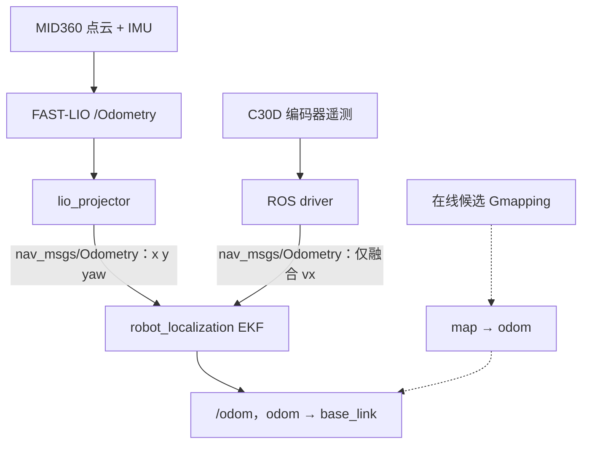

# 架构与源码入口

[返回首页](../README.md)

系统分成定位、感知、规划、控制和空地接口。各层传递标准 ROS 消息，底盘速度闭环在 MCU 内完成。我方已有现场记录的 odom 路径和新增 online 候选复用底层定位与控制；online 候选尚不能继承 odom 的现场结论。

## 0 两个仓库的关系

队友的 [potato-ugv-online-navigation-radio（固定提交 643a704）](https://github.com/20DCYy06/potato-ugv-online-navigation-radio/tree/643a704c5fa042b5e9f08d3c37ddad3a38e8b56a) 与本仓库并列保留，承担不同的学习和复核入口：

| 范围 | 队友仓库 | 本仓库 |
|---|---|---|
| 导航主线 | Gmapping 在线建图，B 样条全局规划封装 + TEB | 已实测 odom 路径采用 GlobalPlanner + DWA；新增 Gmapping online 候选继续复用这条规划/控制链 |
| 通信与任务 | FKIE、状态 relay、航点收存和原 patrol | 保留通信来源，提供 `/ugv/move_base` 单目标 Action；收点到该 Action 尚未接通 |
| 代码与证据 | `workspace_snapshot/` 公开学习快照 | 根目录 `src/`、`tools/` 为我方候选；`reference/` 为选定依赖和对照来源；`docs/history/` 与 `evidence/` 保留历史依据 |

这里的 B 样条插件是在既有 GlobalPlanner 上增加路径平滑封装，不能把两仓库同样出现 GlobalPlanner 理解为规划配置相同。队友配置见固定提交的 [navigation_params.yaml](https://github.com/20DCYy06/potato-ugv-online-navigation-radio/blob/643a704c5fa042b5e9f08d3c37ddad3a38e8b56a/workspace_snapshot/catkin_ws/src/slicer_navigation/config/navigation_params.yaml) 和 [在线入口](https://github.com/20DCYy06/potato-ugv-online-navigation-radio/blob/643a704c5fa042b5e9f08d3c37ddad3a38e8b56a/workspace_snapshot/catkin_ws/src/slicer_navigation_without_mapping/launch/slicer_nav_without_mapping.launch)。

本仓库的 [Slicer 依赖快照](../reference/Slicer_Workspace/) 选自已有工程，共享依赖不等于与队友提交逐文件一致，也不等于两套固件、参数或现场状态相同。不要把两个仓库的工作区混编、交叉覆盖同名包，或同时启动整套导航/传感器/控制入口；单次实验应明确一个工作区及各节点所有者。`reference/` 中的资料也不应整目录加入当前 catkin 源码树。来源和版本边界见 [复现说明](05_sources_and_reproduction.md)。

## 1 定位与 TF



FAST-LIO 是复用的激光惯性里程计，输入中已有 MID360 IMU。原输出使用 `camera_init/body`；队友 `lio_projector.py` 按配置外参投影成 `odom/base_link` 的二维观测，再交给 EKF。

EKF 实际融合 **LIO 的 x/y/yaw，以及 wheel 的 vx**。轮速被 driver 封装成 `nav_msgs/Odometry`，线速度单位 m/s。轮里程计虽然可以计算位姿和角速度，当前融合掩码并不采用轮 yaw/wz；不能用轮系纯转解算角度的偏差直接否定其 vx，也不能拿两套绝对里程计原点差判断尺度。

我方接线中的 TF 配置职责是：

| 变换 | 所有者 |
|---|---|
| `odom → base_link` | 局部 EKF |
| 车体到雷达、IMU 等安装变换 | `sensor_geometry.py` |
| `map → odom` | 仅在线候选中的 Gmapping |
| GNSS 定位 TF | 当前 GNSS 节点不发布 |

FAST-LIO 的 TF 输出在这一接线中关闭，driver 也应沿用 `publish_tf=false`。这是配置上的分工；现场仍要检查实际发布者，避免启动两份定位或误传参数。

EKF 的 `Q(wz)` 已由默认 0.02 调整为 0.2，作用是让由 yaw 间接估计出的角速度更及时变化，不是提高某一路传感器的权重。没有额外把原始 MID360 gyro 或 MCU gyro 接入局部 EKF。LIO 缺失时，单独 wheel vx 不能恢复航向，不能将“EKF还在发布”当作定位仍可靠。

入口：[slicer_sensors.launch](../src/ugv_bringup/launch/slicer_sensors.launch)、[队友 sensors.launch](../reference/Slicer_Workspace/catkin_ws/src/slicer_bringup/launch/sensors.launch)、[投影节点](../reference/Slicer_Workspace/catkin_ws/src/slicer_bringup/scripts/lio_projector.py)、[融合配置](../reference/Slicer_Workspace/.generated/fusion.yaml)、[响应参数](../src/ugv_bringup/config/ekf_velocity_response.yaml)。

## 2 从点云到可通行区域

现用链为：

```text
MID360 → FAST-LIO /cloud_registered_body
       → arm_cloud_filter /cloud_nav_filtered
       → pointcloud_to_laserscan /scan_raw
       → self_scan_filter /scan
       → costmap obstacle / inflation layers
```

这里的 body 点云已经经过 LIO，不是原始雷达回波。arm filter 剔除自身结构，投影按车体系高度和距离筛点，scan filter 剔除车体内回波；Costmap 再标记、清除和膨胀障碍。各层都有可能影响一个物体是否最终进入地图，需沿同一时间窗逐层追踪。

`/scan` 是全周投影，另有 `/scan_front`，不能把后者的前视范围套到导航输入上。`NaN`、`+inf`、有限距离也不是同一语义；没有回波不等于物理空间无障碍。

当前有一个值得接手者注意的配置差异：总配置的 `scan_min_height=0.05`，而实际 sensors launch 加载的 `.generated/scan.yaml` 为 `min_height=0.02`；在线候选冻结的 `.generated/scan.yaml` 又为 0.05。它说明生成配置与上游配置可能不同步；仅看总 YAML 或历史报告不能确定一次运行实际用了什么。现有快照保留原样，现场以加载路径、文件哈希及运行参数一起确认。

新在线候选增加 D455 深度处理和 Costmap 输入，用于补充低位障碍观测；其相机外参、有效距离、失效表现和地面误标仍待现场验证。

入口：[arm filter](../reference/Slicer_Workspace/catkin_ws/src/slicer_navigation/scripts/arm_cloud_filter.py)、[scan filter](../reference/Slicer_Workspace/catkin_ws/src/slicer_navigation/scripts/self_scan_filter.py)、[深度处理](../src/ugv_navigation/scripts/depth_obstacles.py)、[共享 Costmap](../src/ugv_bringup/config/costmap_common.yaml)。

## 3 规划与目标

| 入口 | 默认行为与用途 |
|---|---|
| `odom.launch` | 通用 odom 导航，默认 TEB，用于独立软件/规划路径 |
| `slicer_odom.launch` | Slicer 实车适配入口，默认 DWA，GlobalPlanner 全局规划 |
| `slicer_online.launch` | 新候选：Gmapping + map 全局规划 + 同一 DWA/控制链 |
| `slicer_driver.launch` | 独立 driver；不由导航自动启动 |
| `slicer_gnss.launch` | 独立 GNSS 观测；不接管 EKF 或 TF |

odom 模式的全局和局部 Costmap 随车滚动。扩大窗口可以容纳较远目标，但不会生成窗口外的地图，也不会把未观测格变成已经确认的空地。GlobalPlanner 的 unknown 策略与局部/Guard 的可执行判断需要分开看。

在线候选使用 Gmapping 的 `/map` 及 `map→odom`，全局规划进入 map 坐标，局部控制继续依靠 odom。在线地图初始化尺寸不是实际观测范围。默认 `start_sensors=false`、`start_camera=false`、`connect_control=false`；深度处理默认启用但不代表相机已启动。入口不启动底盘、不发目标、不 release。

`goal.py` 使用标准 `MoveBaseAction`。相对目标在发送前读取一次位姿，把偏移固定到指定世界坐标系；它不是跟随车体不断移动的目标。`--frame` 默认 odom，`--yaw` 默认 0；在线地图目标须明确 frame，缺省 yaw 也不能解释成“朝向随意”。

入口：[Slicer 导航 launch](../src/ugv_bringup/launch/slicer_odom.launch)、[在线 launch](../src/ugv_bringup/launch/slicer_online.launch)、[move_base launch](../src/ugv_navigation/launch/move_base.launch)、[目标客户端](../src/ugv_navigation/scripts/goal.py)。

## 4 速度命令如何变成运动

```text
move_base → /cmd_vel/nav_raw
          → Guard → /cmd_vel/nav
          → Mux   → /cmd_vel
          → ROS driver → 串口 → MCU → 电机
```

真实控制连接需显式 `connect_control=true`；默认隔离输出是 `/ugv/cmd_vel/nav_raw`。Guard 检查命令、状态和轨迹扫掠占用；禁止倒车时拒绝整个非法负 vx 请求。Mux 决定自动与人工来源、保持状态和输出。二者不负责电机速度 PI；Mux startup held 是控制权状态，不是规划器或电机损坏。

driver 有三条显式选择的路径：

| 模式 | 主机发送什么 | 闭环在哪里 |
|---|---|---|
| PWM reference | 将 Twist 映射成四轮 PWM | 主机这条速度映射本身是开环 |
| `wheel_speed / 0x10` | 四轮 int16 目标，mm/s | MCU 四轮速度 PI |
| `body_speed / 0x16` | 车体 vx、wz，协议单位 mm/s、mrad/s | MCU 车体速度外环 + 四轮 PI |

ROS 输入单位仍是 m/s、rad/s。上位机的“转到某个角度”目标先由导航转换成连续速度命令；0x16不是“转多少度”的命令。MCU利用陀螺仪反馈控制角速度，导航根据融合 yaw 控制最终朝向。这种职责划分不要求把MCU陀螺仪再送进EKF。

`0x18` 是最新记录固件新增的输出比例上限接口，在固件工具中可见，**尚未接入我方 ROS driver**。0x10/0x16不经过主机PWM模式的限幅，因此不能从配置里有600‰就推出所有速度模式都受该值约束；最新固件编译上限还由600改成800。实际运行上限和新固件行为须单独验收。

入口：[driver](../src/ugv_slicer_control/scripts/c30d_driver_node.py)、[协议](../src/ugv_slicer_control/scripts/c30d_link.py)、[Guard](../src/ugv_slicer_control/scripts/arc_velocity_guard.py)、[Mux](../src/ugv_slicer_control/scripts/velocity_mux.py)、[MCU控制律](../reference/Slicer_Workspace/firmware/c30d_body_closed_loop/BALANCE/balance.c)。
