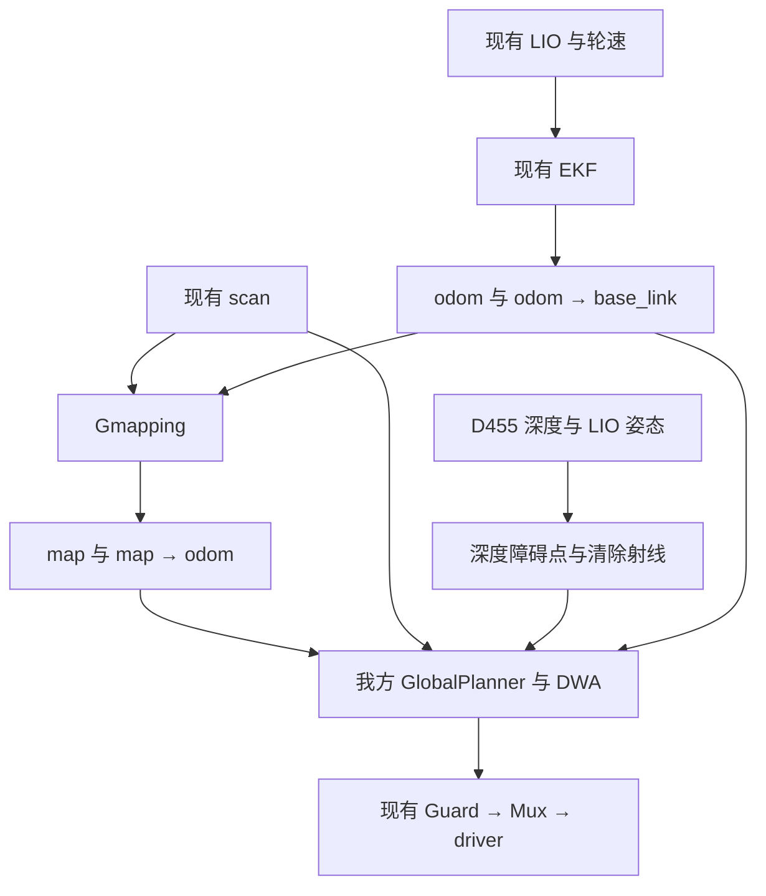

# 在线建图与低位深度避障：离线候选使用说明

日期：2026-10-30（UTC+8）。这是基于车端实物源码快照制作的离线候选，尚未部署到车上。

本地Noetic接手阶段现已完成真实Catkin构建、292项软件测试及安装后检查，
见[本轮实际验证与最短复跑](OFFLINE_NOETIC_VERIFIED_20261030.md)。
下文关于没有Docker、尚未构建的描述保留为收到候选时的历史范围；
传感器运行、ARM部署和实车效果仍未验收。

## 本次交付能做什么

新增 `slicer_online.launch`，复用队友 Gmapping 与 D455 深度处理，同时保留我方已有定位、GlobalPlanner/DWA 和 Guard/Mux 接线。原 `slicer_odom.launch` 仍可使用。不会因为启动在线入口而自动切换成队友的 BSpline/TEB、旧 driver profile 或另一套 EKF。

本轮仅执行纯软件测试和官方 roslaunch XML 展开；没有启动 ROS master、导航、传感器、底盘、串口或任何车端进程。没有 Docker/完整 Noetic 运行时，因此本地完整 Catkin 构建、ROS 集成、真实在线地图和 D455 效果尚未验收。

## 结构与负责边界



- Gmapping 独占 `map→odom`，EKF 独占 `odom→base_link`。LIO 的 TF 开关继续关闭。
- 全局 Costmap 使用 `map`，局部 Costmap 使用 `odom`，后者仍发布完整网格供现有 Guard 检查。
- 深度 hits 只标记障碍；独立 rays 只清除深度层历史。雷达和深度分别维护障碍层，最后统一膨胀。
- 规划器的控制出口仍是 raw 入口，经现有 Guard/Mux 到 driver。新增入口不启动 driver、不自动 release、不发送目标。
- 不新增第二路 IMU、定位融合层、避障控制器或任务状态机。

## 文件入口

| 文件 | 用途 |
| --- | --- |
| `src/ugv_bringup/launch/slicer_online.launch` | 新在线导航组合入口 |
| `src/ugv_bringup/launch/slicer_depth.launch` | 相机/深度感知入口，可复用已经运行的相机 |
| `src/ugv_bringup/config/online_map.yaml` | 全局静态地图层、局部 odom frame、目标容差及全局未知区策略 |
| `src/ugv_bringup/config/gmapping_online.yaml` | 从队友快照复用的 Gmapping 参数 |
| `src/ugv_bringup/config/depth_camera.yaml` | 当前采集到的相机安装、话题、采样和高度参数 |
| `src/ugv_bringup/config/depth_costmap.yaml` | 从队友快照原样复用的两类深度观测和层组合 |
| `src/ugv_bringup/config/online_runtime/` | 安装后仍可读取的冻结传感器配置 |
| `src/ugv_navigation/scripts/depth_obstacles.py`、`depth_geometry.py` | 有来源说明的深度适配副本 |
| `tools/preview_enu_goal.py` | 无 ROS、无发布行为的 ENU 坐标预览 |

`online_runtime` 仅保留 sensors.launch 实际需要的根配置与 MID360/fusion/lio/scan/sensor_launch 文件。没有将队友 `vehicle.yaml` 加载到我方 move_base；它含另一套速度、足迹和膨胀参数。

## 复用中已经处理的问题

1. **运行时路径**：队友包的普通安装规则没有安装 `.runtime`。本候选把必要传感器输入放在我方可安装的 config 下，源码与模拟 share 安装布局均已用官方解析器展开验证。
2. **参数继承**：新入口通过现有 `slicer_sensors.launch` 加载 Q(wz)=0.2；在线 profile 显式使用 xy=0.10m、yaw=0.12rad。已有速度上限、车体足迹、膨胀半径和底盘参数保持原值。
3. **深度输入条件**：沿用 0.5s 时间边界，处理未来/过旧/不对齐及已处理/倒序帧；所有投影内参须有限、焦距为正。正常“无障碍、但有地面清除射线”的帧继续发布，没有增加有效点比例门限。
4. **相机身份**：采集 USB 记录的序列号与两段旧日志不相同。新入口暴露 `camera_serial`；本候选没有把旧日志当成当前安装的低障碍验收。
5. **远目标地图边界**：队友初始 ±20m 不一定容纳场地远目标。本入口将初始范围参数化，默认每轴 ±60m；可根据实际场地缩小。它只是地图分配边界，不是可见距离，也不把未知格标为空闲。

±60m、0.05m 分辨率对应初始 2400×2400、576万格，是原 ±20m 的9倍；单份 int8 栅格数据约5.76MB。多层 Costmap 和 SLAM 的总内存、CPU、发布时延尚未在 Jetson 测量。这里选择了先容纳约40×40m且朝向任意的场地目标；场地尺寸、起点和计算预算确定后可以缩小。

全局 GlobalPlanner 允许经过未知区，局部障碍检查与 Guard 维持现有规则。这不等于具备主动探索能力；实际死路、动态地图更新和未知边界前的行为仍需集成/现场检验。

## 离线开发与测试

源码包提供两个并列目录：`slicer_ugv_ros1/` 和只读参照 `Slicer_Workspace/`。不要把车端复制的 ARM `devel/install` 设置文件 source 到 x86 开发机；候选交付包不依赖这些生成目录。

在已有 Python3、NumPy、PyYAML 的本地环境：

```bash
cd slicer_ugv_ros1
python3 -m unittest discover -s tools -p 'test_*.py' -v
python3 -m unittest discover -s src/ugv_navigation/test -p test_depth_geometry.py -v
```

没有 ROS 解析器时，在线 launch 测试会明确跳过；没有 rosbag 时，原有真实 bag CLI 集成项会明确跳过。跳过不是通过。本次另外准备了未改动的官方 Noetic Python 解析器，实际执行了全部新 launch 测试。

在可使用 Docker 的 Codex 本地环境，先确认基础镜像/依赖可取得。以下用于后续完整软件验证，本轮没有实际构建此镜像：

```bash
cd slicer_ugv_ros1
docker build -t ugv-online-offline:20261030 .
UGV_NOETIC_IMAGE=ugv-online-offline:20261030 ./tools/test_noetic.sh
```

`noetic.sh` 自动识别并只读挂载相邻 `Slicer_Workspace` 的源码；非并列目录时用已有风格的环境变量 `UGV_SLICER_ROOT` 指定。容器继续使用 `--network none`、无设备。新增参考目录仅用于解析包和配置，不 source 它的 ARM 构建结果。Dockerfile 已补列新 profile 所需 ROS/Python 包，构建可用性须在该环境实际验证。

`test_noetic.sh` 在重新 source 本工程 devel 后恢复只读参照包路径，并在
`catkin_make install` 后用干净的 Noetic + install 环境运行
`tools/check_noetic_install.py`。检查包括安装包/可执行脚本路径、辅助模块真实导入来源、
9份冻结配置及在线入口5个分支的官方 XML 展开；只做查找、导入和解析，不启动节点。
外部源码包发现结果与脚本/编译节点是否可执行分别输出；FAST-LIO、Livox 等源码可发现
不代表已构建或传感器可运行。安装检查通过也不能代替实车验证。

若当前环境已有可用 Noetic 与队友包路径，只展开配置，不启动节点：

```bash
python3 tools/test_online_launch.py
```

本轮未改 driver/Guard/Mux 的生产逻辑；现有五组控制纯软件测试仍通过。完整 ROS 软件模型可能继续发现接口问题，不能用本轮 Python 结果代替它。

## 新入口的参数含义

| 参数 | 默认 | 含义 |
| --- | --- | --- |
| `start_sensors` | false | false 时消费现有定位/scan；true 时只启动我方 sensors wrapper，由它保留 EKF overlay |
| `enable_depth` | true | 同时控制深度处理节点和深度 Costmap 层 |
| `start_camera` | false | false 时使用已有相机/录包输入；true 时包含 RealSense 驱动 |
| `camera_serial` | 空 | 透传驱动选择参数；现场核对设备后可填写 |
| `connect_control` | false | 默认规划速度仍在隔离 raw 话题；true 时使用现有 Guard raw 入口 |
| `start_mux` | true | 仅 connect_control=true 时有意义；已有 Mux 时可关闭 |
| `initial_map_half_extent` | 60.0m | 初始地图半宽；不表示传感器覆盖 |
| `local_planner` | dwa | 保留当前主线，teb 仍为显式比较选项 |

默认入口消费已有传感器数据；缺少相机输入时，启用的深度层仍需要它的数据，不把“缺相机”自动当作全空闲。只做激光对照时明确 `enable_depth:=false`，不要把这个对照当作低位障碍已覆盖。

还要区分两种空云：正常地面可产生“空 hits、有效 clearing rays”；整帧没有有效测距时，当前适配副本沿用原模块发布两路空云。后一种情况不表示观察到了自由空间，也不证明低障碍感知有效，持续收到空云也不能代替传感器健康判定。本轮没有新增比例门限或相关状态机；实际失效/清除行为留待同步数据与 ROS 集成验证。

该入口不能与队友整套在线导航同时启动；需要唯一的 EKF、Gmapping、move_base、Guard 和 Mux。适配层复用现有名字便于交接，没有新增控制权系统。

## ENU 离线预览

现有 `goal.py` 已有 `--frame map`，但已有飞机路点接收器只把 JSON 写成 YAML，并不完成 ENU 物理配准。本次不臆造正式飞机协议。

工具采用 `target_from_source` 命名，意义为：

`p_target = R(yaw) * p_source + translation`

可直接提供 `map←ENU`：

```bash
python3 tools/preview_enu_goal.py \
  --east 10 --north 0 \
  --map-from-enu 2 1 1.5707963267948966
```

手算结果为 map 中约 `(2, 11)`。未给 `--target-yaw` 时，输出不杜撰目标朝向。

也可使用同一评估时刻的 `odom←ENU` 与 `map←odom`：

```bash
python3 tools/preview_enu_goal.py \
  --east 2 --north 3 --target-yaw 0.5235987755982988 \
  --odom-from-enu 10 -2 1.5707963267948966 \
  --map-from-odom -1 4 -1.5707963267948966
```

结果约 `(-1, -3)`，yaw约0.5235987756rad。工具只输出诊断 JSON，不发目标，也没有完成实际配准。

正式接入仍需要：飞机传的是目标而非飞机自身位置；ENU共用原点、米/弧度/轴向；目标识别与时间信息；ENU和当前地图的有效配准。map定位校正不必然表示map基准改变，odom连续也不意味着无漂移；地图重建、里程计重启等不能仅凭相同frame名称沿用旧配准。

## 本轮通过范围与下一步

本轮完整合并回归：tools 96项（95通过、1项rosbag集成跳过），控制116/116，深度16/16。合计228项，227通过、1跳过；其中10项在线launch检查和12项ENU预览检查已经包含在tools计数中，不重复相加。来源和详细输出在交付包的 `verification/`。

未完成：完整 Catkin/ROS 节点集成、ARM部署、新在线链同步bag、真实低障碍探测/清除/断流行为、实车导航、ENU外部测量配准。当前低位安装参数是采集到的配置，不是本轮标定结果。

接手 Codex 下一步先在无设备、无外网的本地 Noetic 测试容器中构建并执行 `test_noetic.sh`，处理真实构建或集成失败，再考虑受控实车短目标。无需先重复极低速专项；只有实际导航因此失败时再定位对应段。
